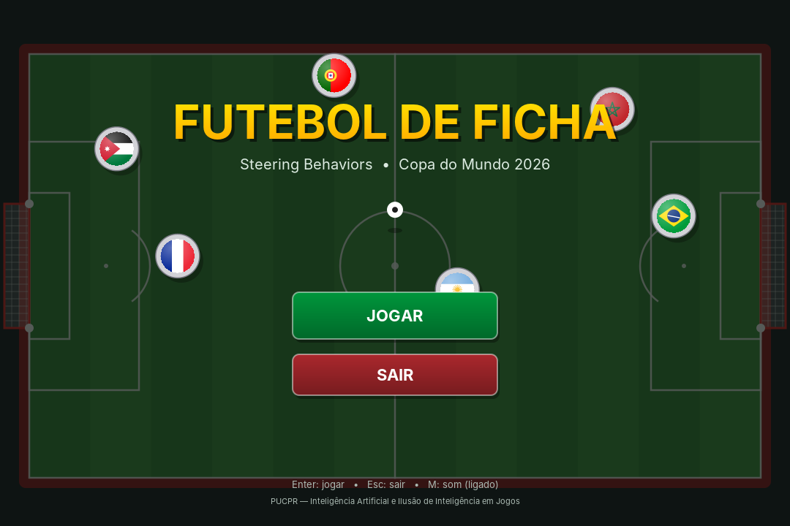
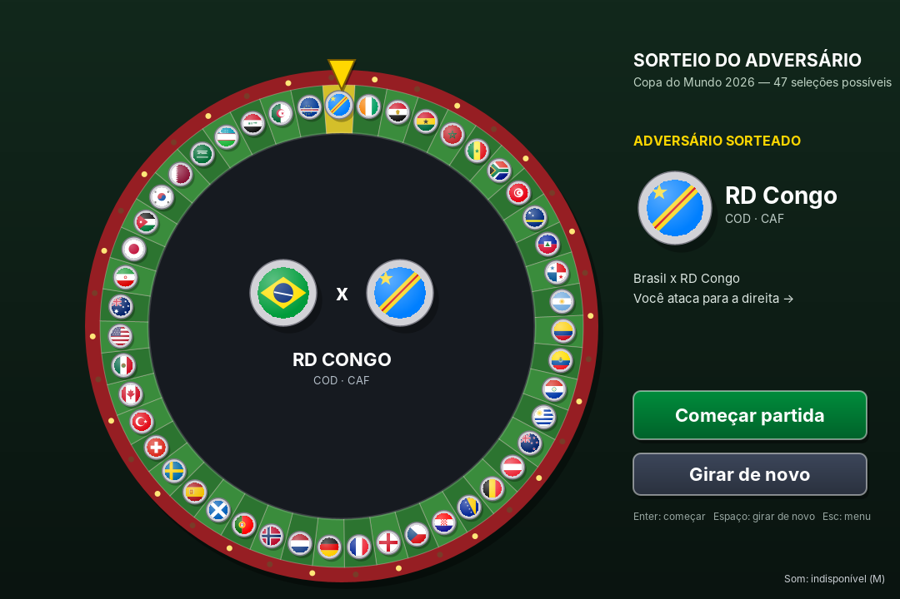
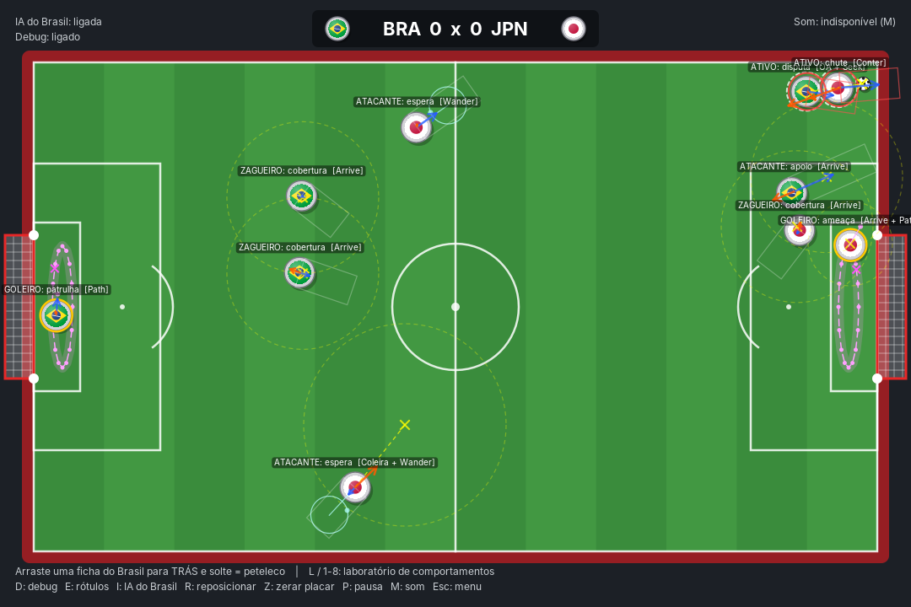
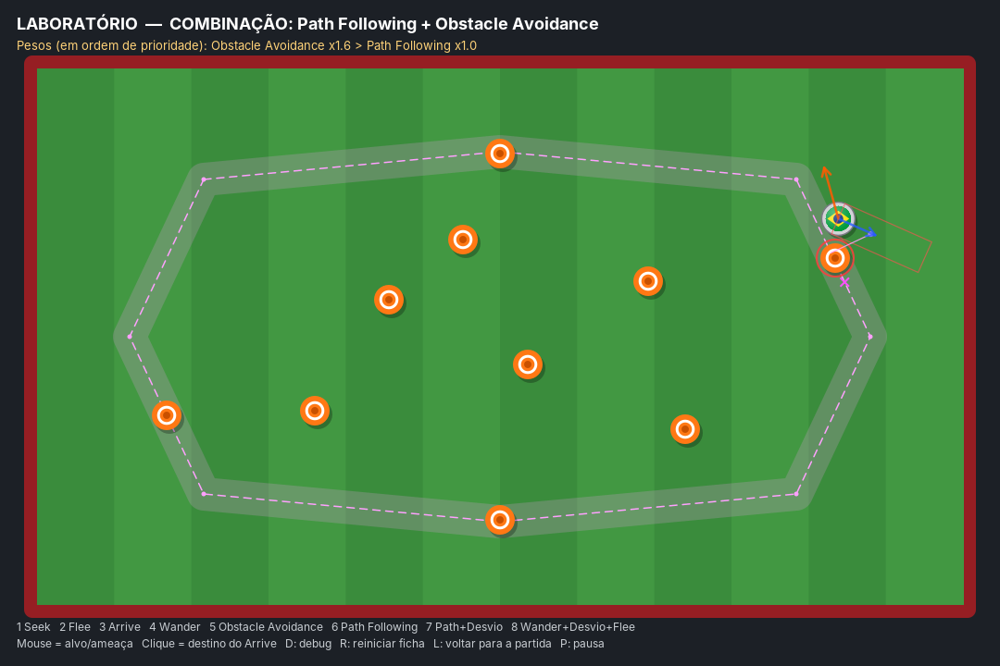

# ⚽ Futebol de Ficha — Steering Behaviors

Trabalho II (prático) de **Inteligência Artificial e Ilusão de Inteligência em Jogos** (PUCPR).

É um futebol de ficha (futebol de botão) em Java/Swing: o **Brasil** enfrenta um adversário sorteado
numa **roleta** entre as 47 outras seleções classificadas para a **Copa do Mundo de 2026**, com 5 fichas de cada lado.
O jogador controla o Brasil dando **petelecos** (puxa a ficha para trás e solta, como num estilingue).
Todas as fichas que não estão sendo lançadas se movem sozinhas, usando **steering behaviors** e
combinações deles. Cada papel (goleiro, zagueiro, atacante) tem a sua combinação.

O projeto também tem um **Laboratório** (mapa de testes) para demonstrar cada comportamento
isolado e as combinações, com cones e um caminho visíveis.

| Menu | Roleta do adversário |
|---|---|
|  |  |




---

## Sumário

1. [Como executar](#como-executar)
2. [Controles](#controles)
3. [Checklist dos requisitos](#checklist-dos-requisitos)
4. [Arquitetura](#arquitetura)
5. [Modelo físico](#modelo-físico)
6. [Comportamentos implementados](#comportamentos-implementados)
7. [Como as forças são combinadas](#como-as-forças-são-combinadas)
8. [Combinações (e por quê)](#combinações-e-por-quê)
9. [Ajuste dos pesos](#ajuste-dos-pesos)
10. [Mapa de testes (Laboratório)](#mapa-de-testes-laboratório)
11. [Outras decisões de jogo](#outras-decisões-de-jogo)
12. [Extras: menu, roleta, seleções e sons](#extras-menu-roleta-seleções-e-sons)
13. [Referências](#referências)

---

## Como executar

Requer **Java 17 ou superior** (o código usa `record` e `switch` com `->`).

**IntelliJ:** abra a pasta do projeto e execute `futebol.Main`.

**Terminal (Linux/macOS):**
```bash
javac -d out $(find src -name "*.java")
java -cp out futebol.Main
```

**Terminal (Windows / PowerShell):**
```powershell
javac -d out (Get-ChildItem -Recurse src -Filter *.java).FullName
java -cp out futebol.Main
```

## Controles

**Menu:** `Enter` ou botão **Jogar** → roleta; `Esc` ou botão **Sair** → fecha o jogo.
**Roleta:** clique (ou `Espaço`) durante o giro para parar de uma vez; depois, `Enter` / **Começar partida**
ou `Espaço` / **Girar de novo**; `Esc` volta ao menu.

**Na partida:**

| Tecla / ação | Efeito |
|---|---|
| **Arrastar uma ficha do Brasil para trás e soltar** | Peteleco (quanto mais longe a puxada, mais forte; máx. 120 px) |
| `L` | Alterna entre Partida e Laboratório |
| `1` … `8` | Abre o Laboratório no comportamento/combinação escolhido |
| `D` | Liga/desliga o debug (vetores, alvos, caixas de detecção, caminhos) |
| `E` | Liga/desliga os rótulos de estado de cada ficha |
| `I` | Liga/desliga a IA do Brasil (desligada = suas fichas só se mexem com peteleco) |
| `R` | Reposiciona as fichas (partida) / reinicia a ficha (laboratório) |
| `Z` | Zera o placar |
| `P` ou `Espaço` | Pausa |
| `M` | Liga/desliga o som (funciona em qualquer tela) |
| `Esc` | Volta ao menu |

**Legenda do debug** (as cores das setas seguem o template da professora):
- Seta **azul**: velocidade. Seta **laranja**: força de steering aplicada.
- **X amarelo** e linha tracejada: alvo do Seek/Arrive. Círculo amarelo tracejado: raio de desaceleração do Arrive.
- **Retângulo** à frente da ficha: caixa de detecção do Obstacle Avoidance (fica vermelho quando detecta algo; o obstáculo detectado ganha um anel vermelho).
- **Círculo ciano**: círculo do Wander (o ponto é o alvo sorteado).
- **Linha rosa tracejada**: caminho. Ponto rosa: posição prevista. **X rosa**: alvo no caminho.
- Círculo vermelho tracejado: raio de pânico do Flee.
- Anel tracejado branco: ficha "ativa" (a que vai na bola) de cada time. Anel dourado: goleiro.

---

## Checklist dos requisitos

| Requisito do enunciado | Onde está |
|---|---|
| Seek | `Comportamentos.seek` — atacante indo chutar; goleiro saindo do gol; Lab `1` |
| Flee | `Comportamentos.flee` — fichas fogem de ficha lançada; Lab `2` e `8` |
| Arrive | `Comportamentos.arrive` — cobertura do zagueiro, posicionamento atrás da bola, goleiro; Lab `3` |
| Wander | `Comportamentos.wander` — atacante esperando a bola; Lab `4` e `8` |
| Obstacle Avoidance | `Comportamentos.evitarObstaculos` — fichas, traves e bola como obstáculos; Lab `5`, `7`, `8` |
| Path Following | `Comportamentos.seguirCaminho` — patrulha do goleiro; Lab `6` e `7` |
| Mapa de testes | Laboratório (`L`): cones + caminho fechado; e o próprio campo |
| ≥ 2 combinações com justificativa | 4 combinações na partida + 2 no laboratório — ver [Combinações](#combinações-e-por-quê) |
| Ajuste de pesos | Todos em `ia/Pesos.java` — ver [Ajuste dos pesos](#ajuste-dos-pesos) |

---

## Arquitetura

```
src/futebol/
├── Main.java              # abre a janela
├── Tela.java              # laço de jogo (passo fixo de 1/120 s), entrada, HUD e cenas
├── Menu.java, Roleta.java, Botao.java   # tela inicial e sorteio do adversário
├── Desenho.java           # todo o desenho (Java2D)
├── selecoes/
│   ├── Selecao.java       # as 48 seleções da Copa 2026 (nome, sigla, bandeira)
│   └── Bandeira.java      # bandeiras simplificadas desenhadas com formas
├── som/
│   ├── Sintetizador.java  # gera os sons por síntese (ruído filtrado, senoides)
│   └── Som.java           # toca os efeitos (Clip), volume, liga/desliga
├── motor/                 # "motor" de steering, independente do jogo
│   ├── Vetor.java         # vetor 2D imutável
│   ├── Agente.java        # física: força → aceleração → velocidade → posição
│   ├── Obstaculo.java     # círculo (ficha, trave, cone, bola)
│   └── Caminho.java       # polilinha com raio, projeção e "andar ao longo"
├── ia/
│   ├── Comportamentos.java  # Seek, Flee, Arrive, Wander, Obstacle Avoidance, Path Following
│   ├── Combinador.java      # soma ponderada com prioridade
│   └── Pesos.java           # TODOS os pesos e parâmetros
├── jogo/
│   ├── Partida.java       # regras: gols, colisões, peteleco, bola presa
│   ├── Tatica.java        # escolhe a combinação de cada ficha (por papel/situação)
│   ├── Ficha.java, Bola.java, Campo.java, Fisica.java, Time.java, Papel.java, Corpo.java
└── lab/
    └── Laboratorio.java   # mapa de testes com os 8 modos
```

A separação é proposital: `motor` e `ia` não sabem que existe futebol. `Tatica` é a camada de
**decisão** (o que fazer agora), e `Comportamentos` é a camada de **movimento** (como se mover).

---

## Modelo físico

Mesmo modelo do template da professora (`Car.update`), em `Agente.atualizar`:

```
força      = truncar(steering, maxForça)
aceleração = força / massa
velocidade = truncar(velocidade + aceleração · dt, maxVelocidade)
posição    = posição + velocidade · dt
```

| Parâmetro | Ficha de linha | Goleiro |
|---|---|---|
| massa | 1,0 | 1,0 |
| maxForça | 650 | 750 |
| maxVelocidade | 210 px/s | 185 px/s |
| raio | 18 px | 18 px |

**Extensão: modo livre (peteleco).** Logo depois de um peteleco, ou de uma pancada forte de outra
ficha, a ficha fica alguns instantes **sem steering**, deslizando só com o atrito da mesa
(`v ← v · e^(−1,4·dt)`). Quando a velocidade cai abaixo de 60% da máxima, a IA volta a controlá-la.
É assim que uma ficha de verdade se comporta, e isso permite que a velocidade do peteleco
(até 1000 px/s) ultrapasse a `maxVelocidade` da IA.

As colisões (ficha × ficha, ficha × bola, traves e paredes) são resolvidas em `Fisica.java` por
impulso com restituição. **Isso não é steering**: é o que acontece quando o steering falha ou
quando o contato é intencional (o chute).

---

## Comportamentos implementados

Todos estão em `ia/Comportamentos.java` e **devolvem uma força**, não uma velocidade.

### 1. Seek (buscar)
```
desejada = normalizar(alvo − posição) · maxVel
steering = desejada − velocidade
```
A ficha acelera em linha reta até o alvo. Por não frear, passa do ponto e volta (no Lab `1`, ela
fica "orbitando" o cursor).
**No jogo:** a ficha ativa, já alinhada, corre *através* da bola em direção ao gol; o goleiro sai
do gol para afastar uma bola muito próxima.

### 2. Flee (fugir)
```
se distância(ameaça) > raioPânico → 0
desejada = normalizar(posição − ameaça) · maxVel
steering = desejada − velocidade
```
É o inverso do Seek, limitado a um **raio de pânico**: ninguém foge de algo que está do outro lado
do campo.
**No jogo:** quando alguém dá um peteleco, as fichas próximas (raio 110 px) fogem da ficha lançada
que vem em alta velocidade (> 260 px/s), como um jogador saindo da frente de uma bola dividida.

### 3. Arrive (chegar)
```
d = distância(alvo)
velDesejada = maxVel                        se d ≥ raioDesaceleração
            = maxVel · d / raioDesaceleração caso contrário
steering = (desejada − velocidade) / tempoReação      (tempoReação = 0,25 s)
```
Igual ao Seek longe do alvo; dentro do raio, a velocidade desejada cai linearmente até zero.
A divisão pelo **tempo de reação** (o "time to target" de Millington) faz a ficha corrigir o erro
em ~0,25 s. Sem ela, a frenagem final fica lenta e a ficha "boia" perto do alvo.

*Por que o raio não pode ser pequeno:* a distância mínima de frenagem é
`maxVel² / (2 · maxForça / massa) = 210² / 1300 ≈ 34 px`. Os raios usados (60 a 140 px) são bem
maiores, então a ficha para sem passar do alvo. No teste automatizado, ela parou a 0,2 px do
clique, sem oscilar.
**No jogo:** zagueiro indo para a posição de cobertura; ativo se posicionando atrás da bola;
goleiro acompanhando a bola na linha; "coleira" do atacante em espera.

### 4. Wander (vagar)
```
ânguloWander += N(0,1) · jitter · √dt
centro = posição + direção · distância
alvo   = centro + (cos, sen)(ângulo(direção) + ânguloWander) · raio
steering = normalizar(alvo − posição) · velWander − velocidade
```
Um círculo é projetado à frente da ficha, e o alvo passeia sobre ele com pequenas variações
aleatórias. Como o alvo só se move um pouco por quadro, a trajetória fica sinuosa mas **contínua**
(sem tremer). A variação é proporcional a `√dt` (passeio aleatório), então o comportamento não
muda com o FPS.
Parâmetros no jogo: distância 45 px, raio 22 px, jitter 2,6, velocidade 110 px/s.
**No jogo:** atacante esperando a bola no campo de ataque, quando ela está no campo de defesa do
seu time.

### 5. Obstacle Avoidance (desvio de obstáculos)
Todos os obstáculos são círculos (fichas, traves, cones e, às vezes, a bola).

1. Uma **caixa de detecção** se estende à frente da ficha, com largura = diâmetro da ficha e
   comprimento = `mín + (vel/maxVel) · mín` (mais rápida → enxerga mais longe).
2. Cada obstáculo é levado para o **espaço local** da ficha (x = frente, y = lado).
3. São descartados os obstáculos atrás, além da caixa, ou com `|y| ≥ raioObst + raioFicha + folga`.
4. Entre os restantes, o mais perigoso é o de **interseção mais próxima** com o eixo x local.
5. Resposta:
   - força **lateral** para o lado oposto ao obstáculo:
     `maxForça · (0,35 + 0,65·urgência) · (0,5 + 0,5·sobreposição)`;
   - **frenagem** leve: `−maxForça · 0,4 · urgência`;
   - `urgência = 1 − interseção/comprimento` (mais perto → mais forte);
     `sobreposição = 1 − |y|/raio` (mais centralizado → mais forte).

**No jogo:** as fichas desviam umas das outras e das traves. Quando a ficha ativa precisa dar a
volta na bola para ficar atrás dela, **a própria bola entra como obstáculo**, para que a ficha a
contorne em vez de empurrá-la para o lado errado.

### 6. Path Following (seguir caminho) — Reynolds
1. **Prevê** a posição futura: `futura = posição + direção · previsão`.
2. **Projeta** `futura` no caminho (o ponto mais próximo em cada segmento).
3. **Anda** `avanço` px adiante no caminho a partir da projeção (passando para o próximo
   segmento se precisar): esse é o alvo.
4. Se a posição futura **sai do corredor** (distância > raio do caminho), faz Seek no alvo.
   Se continua dentro, **não aplica força** (segue reto). Exceção: se estiver lenta, sempre faz
   Seek, para não ficar parada.

**No jogo:** o goleiro patrulha um laço estreito (elipse 12 × 72 px, 16 pontos) na frente do gol.
Isso dá a "ilusão" de um goleiro atento, que se mexe o tempo todo na boca do gol.

### Auxiliar: Contenção
Não é um dos comportamentos pedidos. Se a posição prevista sai de um retângulo, a ficha é
empurrada de volta para o centro dele. Mantém as fichas longe das paredes e o goleiro dentro da área.

---

## Como as forças são combinadas

`ia/Combinador.java` implementa a **soma ponderada truncada com prioridade**
(*weighted truncated running sum with prioritization*, Buckland):

1. As forças são adicionadas **da mais importante para a menos importante**.
2. Cada força é multiplicada pelo **peso** e só pode ocupar o **orçamento restante**
   (`maxForça − |soma até agora|`).
3. Quando o orçamento acaba, as forças seguintes são ignoradas.

**Por que não uma soma ponderada simples?** Na soma simples, um Seek forte pode "cancelar" o
desvio e a ficha bate no obstáculo. Com prioridade, quando há perigo o desvio consome o orçamento
primeiro. Quando não há perigo, o desvio vale zero e o orçamento fica todo para o objetivo. Assim
**a ordem define o que é inegociável** e o **peso define a intensidade**.

Ordem usada em todos os papéis: **Contenção → Flee → Obstacle Avoidance → objetivo do papel**.

---

## Combinações (e por quê)

A camada `Tatica` escolhe a combinação de cada ficha a cada quadro, de acordo com o papel e a
situação. Com o debug ligado, o rótulo de cada ficha mostra o estado e as forças ativas no momento
(ex.: `ZAGUEIRO: cobertura [OA + Arrive]`).

### Combinação 1 — Atacante ativo: *Arrive + Obstacle Avoidance* → *Seek* (+ peteleco)
A ficha de linha mais próxima da bola (com histerese, para não ficar trocando) é a "ativa".
- **Posicionar:** `Contenção 3,0 > Obstacle Avoidance 1,6 (bola incluída) > Arrive 1,0` até um
  ponto 22 px atrás da bola, alinhado com o gol adversário.
- **Chute:** já alinhada (ângulo < ~28°) e perto, a ficha dá um **peteleco** na bola (480 px/s,
  erro de mira de ±4°). Se ainda estiver longe, faz `OA 0,7 > Seek 1,0` através da bola.
- **Disputa:** se um adversário está colado na bola, ou se ela tenta se posicionar por mais de
  1,6 s, deixa de tentar ficar "atrás" e vai direto na bola (`OA 0,7 > Seek 1,0` + peteleco).

*Por quê:* o Seek puro empurraria a bola para qualquer lado, inclusive contra o próprio gol. O
Arrive leva a ficha a um ponto de chute e para ali (sem passar por cima da bola). O OA com a bola
como obstáculo faz a ficha **contornar** a bola. O desvio vem antes porque bater na bola pelo lado
errado é pior que demorar um pouco. Na hora do chute, o OA cai para 0,7: a ficha precisa chegar à
bola mesmo com adversários perto, senão nunca chutaria numa área congestionada.
O steering cuida do **posicionamento**; o peteleco é a **ação** de chutar, que é a mecânica do
futebol de ficha.

### Combinação 2 — Zagueiro: *Flee + Obstacle Avoidance + Arrive*
`Contenção 3,0 > Flee 1,5 (ficha lançada, raio 110) > OA 1,5 > Arrive 1,0` até o ponto de
**cobertura**: na linha entre a bola e o próprio gol, a 50% da distância (no máximo 330 px),
deslocado ±45 px para o lado de cada zagueiro e limitado ao próprio campo.

*Por quê:* o Arrive (e não o Seek) faz o zagueiro **parar** na posição, como um defensor
posicionado, sem passar dela. O Flee tem prioridade porque uma ficha lançada a até 1000 px/s
derruba quem estiver na frente: sair do caminho vale mais que manter a posição. O OA impede que
os dois zagueiros e os atacantes se embolem.

### Combinação 3 — Goleiro: *Path Following* ⇄ *Arrive + Path Following*
- **Patrulha** (bola longe): `Contenção 3,0 > Path Following 1,0` a 95 px/s.
- **Ameaça** (bola a menos de 330 px do gol): `Contenção 3,0 > Arrive 1,0 > Path Following 0,25`.
  O alvo do Arrive fica na linha do gol, na altura prevista da bola (limitada à boca do gol).
- **Saída** (bola a menos de 80 px, com o goleiro entre a bola e o gol): `Seek 1,0` na bola.

*Por quê:* o Path Following dá movimento constante e natural ao goleiro quando nada acontece. Sob
ameaça, o Arrive manda, mas o caminho continua com peso pequeno (0,25), puxando-o de leve para
perto da linha. Com peso maior, os dois brigariam e o goleiro tremeria. A Contenção impede que
ele saia da área.

### Combinação 4 — Atacante em espera: *Wander + Arrive (coleira) + Obstacle Avoidance + Flee*
Quando a bola está no campo de defesa do seu time, o atacante que não é o ativo espera no ataque:
`Contenção > Flee 1,5 > OA 1,5 > Coleira (Arrive) 0,7 > Wander 1,0`.
A "coleira" só existe quando ele se afasta mais de 85 px da sua zona.
Quando a bola vai para o ataque, ele troca para **apoio**: `Arrive 1,0` até um ponto à frente e
ao lado da bola, pronto para receber.

*Por quê:* um atacante parado parece "desligado"; o Wander dá a ilusão de alguém se mexendo para
se desmarcar. Mas o Wander puro levaria o jogador para qualquer lugar do campo, por isso a coleira.
Ela só atua fora do raio porque, se estivesse sempre ativa, frearia o Wander (o Arrive deseja
velocidade zero no alvo), e a ficha ficaria quase parada.

### Combinações no laboratório
- **`7` Path Following + Obstacle Avoidance** (`OA 1,6 > Path 1,0`): o caminho passa por cima
  de cones. No modo `6` (só Path Following) a ficha **bate** nos cones; no modo `7` ela desvia e
  volta ao caminho. No teste automatizado de 30 s: 114 quadros encostando nos cones no modo 6
  contra 0 no modo 7.
- **`8` Wander + Obstacle Avoidance + Flee** (`Contenção 3,0 > Flee 1,5 > OA 1,6 > Wander 1,0`):
  uma "ficha arisca" que passeia pelo campo, desvia dos cones e foge do cursor.

---

## Ajuste dos pesos

Todos os valores estão em `ia/Pesos.java`. O raciocínio usado:

| Peso / parâmetro | Valor | Justificativa |
|---|---|---|
| Contenção | 3,0 (1ª prioridade) | Sair do campo ou da área nunca é aceitável. |
| Flee (ficha lançada) | 1,5 | Escapar de uma pancada vale mais que manter a posição. |
| Raio de pânico | 110 px | ~3 fichas de distância: dá tempo de reagir sem fugir à toa. |
| OA (zagueiro/apoio) | 1,5 | > 1 para o desvio conseguir dominar o orçamento quando é urgente. |
| OA (ativo contornando) | 1,6 | Contornar a bola sem tocá-la é crítico. |
| OA (ativo chutando) | 0,7 | Com desvio forte, o ativo nunca chegaria à bola no meio de adversários. |
| Arrive (objetivos) | 1,0 | Referência; é a última prioridade e usa o orçamento que sobrar. |
| Raio Arrive do zagueiro | 90 px | Bem acima da distância de frenagem (≈34 px): chega suave, sem oscilar. |
| Arrive × Path do goleiro | 1,0 × 0,25 | Com 0,5 ou mais, Arrive e caminho disputavam e o goleiro tremia. |
| Coleira × Wander | 0,7 × 1,0 | O Wander domina; a coleira só corrige quando ele se afasta. |
| Tempo de reação do Arrive | 0,25 s | Com 1 s (sem divisão), a ficha levava vários segundos para assentar. |
| Peteleco da IA | 480 px/s | Com o chute só por contato (~300 px/s na bola), quase não havia gols; com 480, saíram cerca de 6 a 11 gols a cada 10 min de simulação. |

Os valores foram ajustados com simulações sem interface (10 min de partida, IA x IA), observando:
gols por partida, ausência de fichas sobrepostas, ausência de bola presa por longos períodos e,
no laboratório, colisões com cones, oscilação no Arrive e desvio médio do caminho.

---

## Mapa de testes (Laboratório)

Tecla `L` (ou `1` a `8`). Uma única ficha, **10 cones** (4 deles sobre o caminho) e um
**caminho fechado** de 8 pontos.

| Tecla | Modo | O que observar |
|---|---|---|
| `1` | Seek no cursor | Passa do alvo e "orbita" (Seek não freia). Bate nos cones. |
| `2` | Flee do cursor | Só foge quando o cursor entra no raio de pânico (180 px). |
| `3` | Arrive no clique | Desacelera dentro do círculo de 140 px e para exatamente no ponto. |
| `4` | Wander | Trajetória sinuosa e suave; círculo do Wander visível. |
| `5` | Obstacle Avoidance | Persegue o cursor desviando dos cones (caixa de detecção visível). |
| `6` | Path Following | Segue o caminho; sem desvio, bate nos cones. |
| `7` | Path + OA | Segue o caminho e contorna os cones. |
| `8` | Wander + OA + Flee | Passeia, desvia e foge do cursor. |

Os pesos de cada modo aparecem no topo da tela.

---

## Outras decisões de jogo

- **Tempo real, não por turnos.** O futebol de ficha tradicional é por turnos, mas steering
  behaviors só fazem sentido com agentes se movendo continuamente. Por isso, as fichas se
  posicionam sozinhas e o jogador interfere com petelecos.
- **IA do Brasil ligável (`I`).** Com ela desligada, as fichas do Brasil só se movem com peteleco
  (estilo "raiz"), contra o adversário controlado pela IA.
- **Ficha mirando fica parada.** Enquanto você puxa a ficha, a IA não a move.
- **Bola presa.** Se a bola fica parada por 3,5 s (por exemplo, prensada entre duas fichas ou
  contra a parede), ela é reposta 90 px mais para o meio do campo.
- **Bola na parede.** Com a bola colada numa parede, não dá para ficar "atrás" dela na direção do
  gol. Nesse caso a ficha ativa empurra a bola **ao longo** da parede (para frente e um pouco para
  dentro). Na linha de fundo adversária, empurra para a boca do gol.
- **Passo fixo.** A física roda em passos de 1/120 s (quadros lentos são subdivididos) para as
  colisões ficarem estáveis em qualquer máquina.

---

## Extras: menu, roleta, seleções e sons

Nada disto mexe nos steering behaviors; são extras de apresentação.

- **Menu** (`Menu.java`): botões **Jogar** e **Sair**, com fichas de várias seleções girando em
  volta do título.
- **Roleta** (`Roleta.java`): as 47 seleções ficam em fatias de uma roda. Ao clicar em Jogar, a
  roda dá 5 voltas e desacelera com *ease-out cúbico* (`1 − (1 − t)³`) por 5,5 s até parar com o
  sorteado sob o ponteiro. O sorteio é feito **antes** da animação (`Random.nextInt(47)`), e a
  rotação final é calculada para cair nessa fatia. Assim todas as seleções têm a mesma chance:
  num teste com 4.700 giros, cada seleção saiu entre 81 e 122 vezes (o esperado é 100).
- **Seleções** (`selecoes/Selecao.java`): as 48 classificadas para a Copa de 2026 (lista final,
  fechada nas repescagens de 31/03/2026), com sigla FIFA e confederação. As bandeiras são
  desenhadas com formas simples (faixas, círculos, estrelas, cruzes), sem imagens externas. O
  artigo de cada nome gera o texto do gol: "GOL **DO** JAPÃO", "GOL **DA** FRANÇA", "GOL **DOS**
  ESTADOS UNIDOS", "GOL **DE** PORTUGAL".

| Confederação | Seleções |
|---|---|
| Anfitriões | Canadá, Estados Unidos, México |
| AFC | Austrália, Arábia Saudita, Catar, Coreia do Sul, Irã, Iraque, Japão, Jordânia, Uzbequistão |
| CAF | África do Sul, Argélia, Cabo Verde, Costa do Marfim, Egito, Gana, Marrocos, RD Congo, Senegal, Tunísia |
| CONCACAF | Curaçao, Haiti, Panamá |
| CONMEBOL | Argentina, **Brasil**, Colômbia, Equador, Paraguai, Uruguai |
| OFC | Nova Zelândia |
| UEFA | Alemanha, Áustria, Bélgica, Bósnia e Herzegovina, Croácia, Escócia, Espanha, França, Holanda, Inglaterra, Noruega, Portugal, Suécia, Suíça, Tchéquia, Turquia |

- **Sons** (`som/`), ligados/desligados com `M`:

| Som | Quando toca | Como é gerado |
|---|---|---|
| Torcida | Em loop durante a partida | **Gravação real** (`src/sons/torcida.wav`). O fim do arquivo foi misturado com o começo (*crossfade* de 1,5 s) para o loop não ter emenda, e o volume foi normalizado. Sem o arquivo, usa a versão sintetizada (ruído filtrado + ~70 "vozes") |
| Peteleco | Quando você (ou a IA) dá um peteleco | "Tlec": estalo agudo de ruído (a unha) + ressonância de plástico + leve chiado do deslize; o seu peteleco soa mais alto que os da IA |
| Ficha na bola | Quando uma ficha toca a bola | "Toc" grave: senoide amortecida (~520 Hz) com ataque de ruído |
| Ficha em ficha | Quando duas fichas se chocam | "Clac" de plástico: três senoides agudas (1,8 / 3,1 / 4,7 kHz) que somem rápido |
| Gol | A cada gol | **Gravação real** (`src/sons/gol.wav`), com volume normalizado. Sem o arquivo, usa a versão sintetizada (explosão da torcida + vozes + buzina) |
| Tique / revelação | Roleta passando por cada seleção / parando | Senoide curta / acorde que decai |

  O volume dos choques acompanha a **força do impacto** (o impulso da colisão calculado em
  `Fisica.colidir`). Choques fracos demais (fichas apenas encostadas) não fazem som. A `Partida`
  só avisa os acontecimentos por uma interface (`Partida.Ouvinte`); quem decide tocar o som é a
  `Tela`. **Torcida e gol** usam as gravações em `src/sons/`; os demais são **sintetizados no
  código** (sem arquivos de áudio). Qualquer som pode ser trocado por uma gravação: basta
  colocar `torcida.wav`, `bola.wav`, `fichas.wav`, `gol.wav`, `peteleco.wav`, `tique.wav` ou
  `revelacao.wav` em `src/sons/`. O jogo procura o arquivo no classpath e, se não achar, direto
  em `src/sons/`, então funciona tanto no IntelliJ quanto compilando pelo terminal. Se o
  computador não tiver saída de áudio, o jogo roda em silêncio.

  **Créditos dos áudios gravados:**
  - `torcida.wav`: "Crowd cheering in stadium", de *vishiv* (arquivo original
    `vishiv-crowd-cheering-in-stadium-435357.wav`).
  - `gol.wav`: "Goool — Efecto de sonido" (arquivo original `Goool-_-Efecto-de-sonido.wav`).
  - *Completar com o site de origem e a licença de cada um.*

---

## Referências

- REYNOLDS, C. W. *Steering Behaviors For Autonomous Characters*. GDC, 1999.
- BUCKLAND, M. *Programming Game AI by Example*. Wordware, 2005 (cap. 3: Obstacle Avoidance e
  combinação por soma truncada com prioridade).
- MILLINGTON, I.; FUNGE, J. *Artificial Intelligence for Games*. 2. ed. CRC Press, 2009 (Arrive
  com *time to target*).
- Template `SBCarsEngine` da Prof.ª Marina de Lara (modelo físico de força/massa/velocidade).
